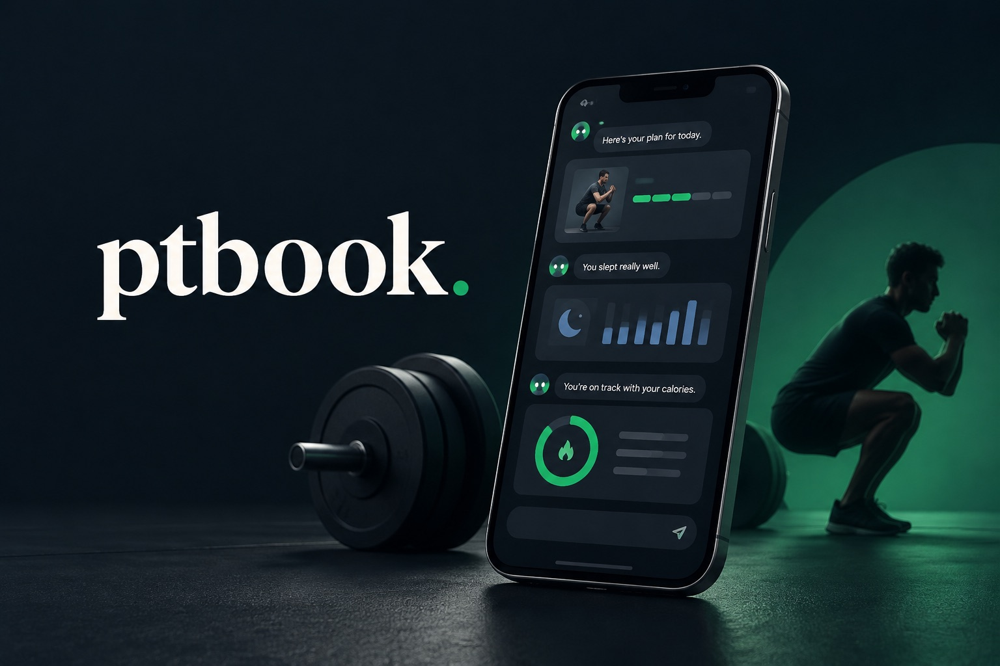
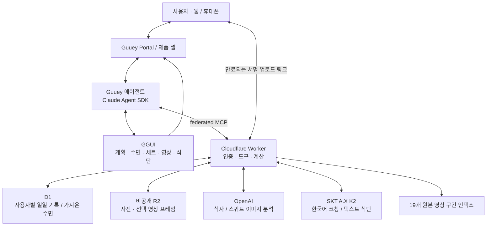

<p align="center"></p>

<h1 align="center">ptbook</h1>

<p align="center"><strong>진짜 PT해주는 에이전트.</strong><br />오늘 계획부터 마지막 세트, 식사 기록까지.</p>

<p align="center">
  <a href="https://app.guuey.com/agent/78537711-e685-469d-b2fe-8bf378b1cdfc"></a>
  &nbsp;
  <a href="https://docs.guuey.com/"></a>
  &nbsp;
  <a href="#설치"></a>
  &nbsp;
  <a href="#라이선스와-서드파티"></a>
</p>

**ptbook**은 혼자 운동하는 사람을 위한 한국어 PT 에이전트입니다. 수면을 참고해 오늘의 운동 계획을 만들고, 세트가 끝나면 기록과 다음 행동을 함께 보여줍니다. 자세가 궁금하면 보디빌더의 설명 구간을 찾아주고, 식사 사진이나 텍스트를 보내면 칼로리와 탄단지를 바로 기록합니다.

운동 앱의 화면을 하나씩 찾아다니는 대신, 지금 필요한 화면이 대화 옆에 나타납니다. 계획은 표로, 세트는 다음 행동으로, 식사는 큰 칼로리 숫자로 보여줍니다. **먼저 기록하고, 틀린 부분은 대화로 고칩니다.**

<table>
  <tr>
    <td width="50%"><strong>오늘 어떻게 운동할까?</strong><br />수면을 반영한 계획표와 운동별 완료 세트.</td>
    <td width="50%"><strong>방금 세트, 뭘 바꿀까?</strong><br />기록 요약, 짧은 한국어 코칭, 다음 세트 행동.</td>
  </tr>
  <tr>
    <td><strong>자세는 어떻게 고칠까?</strong><br />스쿼트 프레임 분석과 실제 설명 영상의 해당 구간.</td>
    <td><strong>오늘 얼마나 먹었을까?</strong><br />식사 사진·텍스트 기록, 칼로리·탄단지 누적과 수정.</td>
  </tr>
</table>

[Guuey에서 체험하기](https://app.guuey.com/agent/78537711-e685-469d-b2fe-8bf378b1cdfc) · [3분 데모 시나리오](#데모-시나리오) · [아키텍처](#아키텍처)

## 설치

직접 체험하려면 위 링크에서 **Start Chat**을 누르세요. 소스 실행에는 Node.js 22 이상, pnpm, 테스트용 Bun이 필요합니다. Guuey CLI와 Wrangler는 프로젝트 의존성에 포함되어 있습니다.

```sh
git clone https://github.com/changeroa/ptbook.git
cd ptbook
pnpm install
pnpm bootstrap
pnpm dev
```

`bootstrap` 안내에 따라 로컬 모델 키와 Guuey 연결을 설정합니다. 개발 화면은 `http://localhost:6890`, 로컬 에이전트는 `http://localhost:6790`, GGUI는 `http://localhost:6781`입니다. `pnpm dev`가 이 세 프로세스와 에이전트 빌드 감시를 함께 실행합니다.

**복제한 프로젝트는 자신의 Guuey 앱과 Worker에 연결하세요.** 현재 `guuey.json`의 앱 ID·외부 MCP 주소와 Wrangler의 D1·R2 설정은 이 데모 배포를 가리킵니다. 공개 소스만 복제한다고 해당 계정의 모델 키나 건강 데이터 접근 권한이 생기지는 않습니다.

<details>
<summary>이미 배포된 에이전트에 로컬 제품 셸만 연결하기</summary>

```sh
pnpm bootstrap -- --link
pnpm --filter @ptbook/web dev
```

이 경로는 Vite 제품 셸을 실행합니다. Guuey 에이전트 배포와 정적 웹사이트 배포는 별개이며, 공개 체험의 기본 진입점은 Guuey Portal입니다.

</details>

<details>
<summary>로컬 MCP와 별도 Cloudflare 배포 준비</summary>

`mcps/ptbook/wrangler.jsonc`의 Worker 이름, D1 데이터베이스, R2 버킷을 자신의 리소스로 바꿉니다. D1 바인딩 이름은 `DB`, R2 바인딩 이름은 `MEDIA`를 유지합니다.

```sh
# mcps/ptbook에서 실행
cd mcps/ptbook
pnpm exec wrangler login
pnpm exec wrangler d1 create ptbook-healine
pnpm exec wrangler r2 bucket create ptbook-media
```

생성 결과의 데이터베이스 ID와 버킷 이름을 Wrangler 설정에 반영합니다. 이름이 이미 사용 중이면 자신의 이름을 선택하세요. 일일 기록 테이블은 저장소의 마이그레이션으로 만듭니다.

```sh
pnpm exec wrangler d1 migrations apply ptbook-healine --local
pnpm dev
```

Worker 로컬 비밀값은 Git에서 제외되는 `.dev.vars`에 설정합니다. 필요한 이름은 아래 환경변수 표를 참고하세요. 외부 MCP 주소를 로컬 주소로 바꾸는 것은 **로컬 에이전트 개발용**이며, Guuey 호스팅에서는 공개 HTTPS Worker 주소가 필요합니다. 실제 MCP 호출에는 Guuey federation 토큰 또는 비공개 운영자 검증 토큰이 필요합니다.

수면 데이터베이스의 `data_source`, `event_record`, `sleep_details`는 별도로 가져온 Healine 스키마입니다. 이 저장소에는 개인 건강 덤프가 없습니다. 수면을 연결하지 않은 체험 계정은 예시 수면을 사용하고, 자신의 실측 데이터를 연결하려면 해당 스키마와 서버 측 사용자 매핑을 따로 준비해야 합니다.

</details>

## 어떻게 동작하나요?

ptbook은 **OBA.RUN에서 만든, 세트 사이의 짧은 판단을 돕는 에이전트**입니다. 처음부터 운동 기록장을 하나 더 만드는 것이 목표는 아니었습니다. 혼자 운동하는 사람이 “방금 무엇이 달랐고, 다음 세트에는 무엇을 바꿔야 하지?”를 바로 해결하는 것이 출발점입니다.

대상은 운동을 시작했거나 중량을 늘리는 한국어 사용자입니다. 기록 앱, 운동 영상, 수면 데이터가 있어도 그 정보를 지금의 행동으로 연결하는 일은 여전히 사용자에게 남습니다. ptbook은 그 연결을 맡습니다.

1. **오늘 계획을 만듭니다.** 수면을 참고해 하체 운동 계획을 만들고 저장합니다. 짧은 수면에는 보조운동 세트를 줄이는 데모 규칙을 사용합니다.
2. **끝낸 세트를 바로 남깁니다.** 운동·중량·횟수를 말하면 저장하고 계획표의 진행을 갱신합니다. 같은 요청이 다시 도착해도 중복 기록하지 않습니다.
3. **다음 행동을 하나 고릅니다.** A.X K2가 보고한 내용에 근거한 짧은 한국어 피드백을 제공합니다. 자세 설명이 필요하면 실제 영상 구간을 찾아줍니다.
4. **사진과 영상으로 보완합니다.** 서명된 업로드 링크로 식사 사진이나 스쿼트 영상을 보내고 분석합니다. 영상은 브라우저에서 추출한 선택 프레임을 사용합니다.
5. **하루 기록을 이어갑니다.** 식사는 분석 후 바로 저장하고, “밥 반공기였어”처럼 말하면 같은 기록을 수정합니다. 새로고침 후에는 서버의 일일 상태를 다시 읽습니다.

원래 기획의 중심은 **계획 → 세트 기록 → 관찰과 근거 → 다음 행동 → 계획 진행 갱신**입니다. 초기 설계의 적용 확인·사용자 home 원장에서, 현재 구현은 D1 영속 저장과 즉시 기록·사후 수정으로 바뀌었습니다. 운동 계획이 중심이고 수면과 식단은 그 계획을 돕는 맥락입니다.

### 왜 generative UI인가요?

운동 중에는 긴 답변을 읽거나 여러 메뉴를 탐색하기 어렵습니다. 같은 대화에서도 계획을 볼 때는 표가, 세트를 마쳤을 때는 한 가지 코칭이, 식사 후에는 칼로리와 누적 게이지가 필요합니다.

Guuey의 대화·인증·제품 셸을 재사용하고, **GGUI가 상황에 맞는 카드와 데이터를 연결**하게 했습니다. 매번 임의의 화면을 생성하는 대신 계획·수면·세트·영상·식단의 다섯 대표 blueprint를 준비합니다. 구조가 같으면 기존 카드의 props를 `ggui_amend`로 갱신합니다.

채팅이나 인증을 새로 만드는 데 쓰는 시간을 줄이고, 기록이 실제로 저장되고 다음 세트의 행동이 바뀌는 흐름에 집중했습니다.

## 아키텍처



대화 이력은 Guuey가 관리합니다. 계획·세트·식사는 Worker가 D1의 `ptbook_day_state`에 인증된 subject와 날짜로 저장합니다. 모델이 임의의 사용자 ID를 지정하지 않으며, revision 검사와 request ID로 충돌·중복 요청을 구별합니다. 날짜 기준은 `Asia/Seoul`입니다.

Healine에서 가져온 수면은 허용된 본인 계정에만 연결됩니다. 다른 사용자의 체험용 수면은 분리되어 있습니다. 사진과 프레임은 비공개 R2에 저장하고 만료되는 서명 링크로 접근합니다.

<details>
<summary>프로젝트 구성</summary>

```text
guuey.json                  Guuey 앱·모델·외부 MCP 연결
prompts/system.md           코칭과 기록, 카드 선택 규칙
src/worker.ts               Guuey 에이전트 호스트
src/ledger.ts               blueprint 읽기와 관련 도구
web/                       제품 셸과 모바일 진입 화면
ggui/blueprints/            다섯 대표 카드와 pool 산출물
ggui/registry.json          논리 variant와 계약
mcps/ptbook/
  src/                     인증·일일 기록·코칭·업로드·분석
  assets/                  업로드 페이지·영상 구간·승인된 분석 캐시
  migrations/              일일 상태 D1 테이블
  wrangler.jsonc           Worker·D1·R2 바인딩
tests/                     원장과 영속 저장 테스트
```

</details>

## 도구

에이전트는 다음 MCP 도구를 조합합니다. 사용자에게 도구 이름을 외울 필요는 없습니다.

| 역할 | 도구 | 결과 |
| --- | --- | --- |
| 하루와 수면 | `get_day_state`, `get_sleep` | 저장된 하루 상태, 수면 근거 |
| 운동 계획 | `get_today_plan`, `get_workout_plan`, `update_workout_plan` | 수면을 반영한 계획과 수정·진행 |
| 세트 | `log_set`, `get_recent_sets`, `set_feedback` | 기록과 다음 세트 행동 |
| 영상 근거 | `find_reference_clips` | 제작자·운동명·타임스탬프가 있는 원본 링크 |
| 업로드·스쿼트 | `create_upload_link`, `get_media_actions`, `analyze_squat_video` | 서명 링크, 선택 프레임 분석 |
| 식사 | `estimate_meal`, `analyze_meal_photo`, `log_meal`, `correct_meal` | 바로 기록되는 식사와 같은 식사의 수정 |
| 누적·카드 | `get_daily_nutrition`, `remember_card` | 칼로리·탄단지 합계, 카드 갱신 참조 |

## 사용 방법

### 대화로 시작하기

```text
오늘 하체 해도 돼?
스쿼트 100kg 8개, 마지막 2개 무릎 모였어.
어떻게 고쳐?
스쿼트 영상 올릴게.
점심에 닭가슴살이랑 밥 한 공기 먹었어.
밥 반공기였어.
오늘 운동이랑 식사 정리해줘.
```

중량과 식사는 대화 예시입니다. 실제로 수행하거나 먹은 값을 말하세요. 세트 기록만으로 자세를 봤다고 판단하지 않으며, 자세 영상은 링크를 열어 직접 업로드합니다. 식사 사진도 에이전트가 보내주는 **사진 올리기** 링크를 사용합니다.

### 데모 시나리오

3분 동안 한 사람의 하루를 이어 보여주는 흐름입니다.

| 시간 | 입력·행동 | 보여줄 장면 |
| --- | --- | --- |
| 0:00 | “혼자 운동하면 세트 끝나고 뭘 고칠지 모른다.” | 오늘의 계획이 중심인 PT 에이전트 소개 |
| 0:20 | “오늘 하체 해도 돼?” | 수면 카드와 조정된 계획표. 짧은 수면 조건에서 총 9세트가 7세트로 줄어드는 예시 |
| 0:50 | “스쿼트 100kg 8개, 마지막 2개 무릎 모였어.” | 즉시 세트 기록, K2 한국어 피드백, 다음 행동과 완료 수 갱신 |
| 1:30 | “어떻게 고쳐?” | [황철순 스쿼트 01:21](https://www.youtube.com/watch?v=l4ikp5rDWXw&t=81s) 설명 구간. 업로드가 준비됐다면 자신의 영상도 분석 |
| 2:10 | 식사 사진 업로드 후 “밥 반공기였어.” | 칼로리·탄단지·오늘 누적을 바로 표시하고 같은 식사 수정 |
| 2:40 | 새로고침 후 오늘 기록 조회 | 저장된 계획·세트·식사 복원, Guuey·GGUI·A.X K2·OpenAI·Polar/Healine 역할 소개 |

체험 계정은 예시 수면을 사용합니다. 실제 수면 기록은 허용된 계정에서만 보여주며, 9→7세트는 데모 규칙의 예시이지 모든 사람의 운동 처방이 아닙니다. 저장된 소유자 스쿼트 샘플을 사용할 때는 새 영상 분석이 아니라 **저장된 분석**으로 소개합니다.

### 직접 배포하기

1. 자신의 Guuey 앱을 만들거나 연결하고 `guuey.json`을 갱신합니다.
2. 자신의 Cloudflare D1·R2와 Worker를 준비합니다. 아래 이름으로 Worker secrets를 등록하고 `PTBOOK_APP_ID`를 자신의 Guuey 앱에 맞춥니다.
3. D1 마이그레이션을 적용하고 Worker를 배포합니다.
4. 반환된 HTTPS 주소에 `/mcp/`를 붙여 `guuey.json`의 외부 MCP URL을 설정합니다. `federate: true`와 끝의 `/`를 유지합니다.
5. Guuey 에이전트를 배포하고 Portal에서 도구·저장·카드 흐름을 확인합니다.

```sh
# mcps/ptbook에서 실행: 자신의 설정과 secrets 준비 후
pnpm exec wrangler d1 migrations apply ptbook-healine --remote
pnpm deploy

# 저장소 루트에서 실행
cd ../..
pnpm build
pnpm exec guuey deploy --code
```

프런트엔드를 따로 호스팅하려면 `pnpm --filter @ptbook/web build`로 Vite 산출물을 만들고 자신의 정적 호스팅에 배포합니다. Guuey Portal만 사용하는 데에는 별도 프런트엔드 배포가 필요하지 않습니다.

<details>
<summary>환경변수와 바인딩</summary>

값은 공개 문서에 넣지 않습니다. Worker secrets는 `mcps/ptbook`에서 `pnpm exec wrangler secret put NAME`으로 등록합니다.

| 이름 | 위치 | 용도 |
| --- | --- | --- |
| `ANTHROPIC_API_KEY` | 로컬 `.env.local` | Claude 에이전트 로컬 실행 |
| `PTBOOK_AX_KEY` | Worker secret | A.X K2 코칭·텍스트 식단 |
| `PTBOOK_OPENAI_KEY` | Worker secret | 이미지 분석 |
| `PTBOOK_MEDIA_SIGNING_KEY` | Worker secret | 업로드·미디어 링크 서명 |
| `PTBOOK_APP_ID` | Worker secret | 허용할 Guuey 앱 |
| `PTBOOK_OWNER_SUB`, `PTBOOK_HEALINE_SUB` | Worker secrets | 본인 Guuey 계정과 수면 데이터 매핑 |
| `PTBOOK_ADMIN_TOKEN` | Worker secret, 선택 | 비공개 운영자 검증 |
| `PTBOOK_VISION_MODEL`, `PTBOOK_DUMP_AS_OF` | Worker 설정 | 이미지 모델, 가져온 수면의 기준 시각 |
| `DB`, `MEDIA` | Wrangler 바인딩 | D1, 비공개 R2 |

`.env.local`, `.dev.vars`, 원본 사진·영상, 건강 덤프는 커밋하지 않습니다. 운영자 토큰을 브라우저나 카드 props에 넣지 마세요. MCP는 Guuey federation의 서명·issuer·audience·만료·앱을 검증하고, 실측 수면은 서버의 본인 매핑을 거칩니다.

</details>

### 검증

```sh
pnpm typecheck
pnpm --filter @ptbook/mcp typecheck
bun test tests mcps/ptbook/tests
pnpm build
pnpm --filter @ptbook/web build
pnpm --filter @ptbook/mcp build
```

마지막 명령은 Wrangler의 배포 dry run입니다. GGUI를 수정했다면 `ggui/`에서 `node scripts/build-pool.mjs`와 `node scripts/check.mjs`도 실행합니다.

## 자주 묻는 질문

**일반 운동 기록 앱과 무엇이 다른가요?**

기록에서 끝나지 않고 다음 세트의 행동까지 연결합니다. 수면·운동·식단이 같은 대화에서 쓰이고, 영상 검색도 지금 질문한 자세의 설명 구간으로 이어집니다.

**무엇이 실제이고 무엇이 데모인가요?**

A.X K2·OpenAI 호출, D1 기록 저장, R2 업로드는 실제 경로입니다. Healine 수면은 가져온 기록으로 실시간 동기화가 아니며, 체험용 수면은 예시입니다. 소유자 스쿼트 샘플은 저장된 분석 캐시입니다. 영양값은 추정이며 운동·영양 안내는 의료 진단이 아닙니다.

**다른 기기에서도 같은 기록이 보이나요?**

같은 인증 식별자와 날짜로 서버 기록을 읽습니다. 다른 브라우저나 기기에서 새 게스트로 시작하면 별도 사용자입니다. 제품 셸과 Portal은 로그인·대화가 별개이므로 QR을 열었다고 기존 스레드나 기록이 자동 이관되지는 않습니다.

**모든 운동과 모든 영상을 분석하나요?**

현재 계획은 하체 중심이고, 영상 분석은 짧은 스쿼트의 선택 프레임을 봅니다. 참고 영상 검색은 김성환·짐승철·황철순의 19개 구간 인덱스입니다. 실시간 전신 자세 측정이나 웹 전체 영상 검색은 아닙니다.

**소스만 받으면 모든 외부 API를 계속 쓸 수 있나요?**

Guuey·Cloudflare·모델 제공자의 계정과 사용 권한이 필요합니다. OBA.RUN 행사 제공 A.X 키는 행사 조건과 만료를 따르므로 자신의 유효한 자격증명을 준비해야 합니다.

## 라이선스와 서드파티

이 저장소에는 아직 별도 `LICENSE`가 없습니다. 코드 공개를 MIT 등 특정 오픈소스 라이선스의 부여로 해석하지 마세요. 재사용 조건은 저장소 소유자에게 확인할 수 있습니다.

- **Guuey / GGUI:** 에이전트 호스팅·대화·생성 UI. [Guuey 문서](https://docs.guuey.com/)와 [GGUI 문서](https://docs.ggui.ai/)를 참고하세요.
- **SKT A.X K2 / OpenAI:** 한국어 코칭과 이미지 분석. 각 API의 이용 조건과 과금이 적용됩니다.
- **Polar / Healine:** 수면 원천과 가져오기 경로. 개인 건강 덤프는 배포된 공개 소스에 포함하지 않습니다.
- **운동 영상:** 원본 제작자에게 권리가 있습니다. 저장소는 출처·타임스탬프를 연결하며 영상을 재배포하지 않습니다.
- **소유자 스쿼트 분석:** 공개가 승인된 텍스트 분석 캐시만 포함합니다. 원본 인물 영상·프레임은 공개하지 않습니다.
- **패키지:** 각 의존성의 라이선스와 제공 조건은 해당 패키지를 따릅니다.

<sub>문제나 개선 제안은 <a href="https://github.com/changeroa/ptbook/issues">Issues</a>로 남겨주세요. 개인정보나 API 키는 첨부하지 마세요.</sub>
